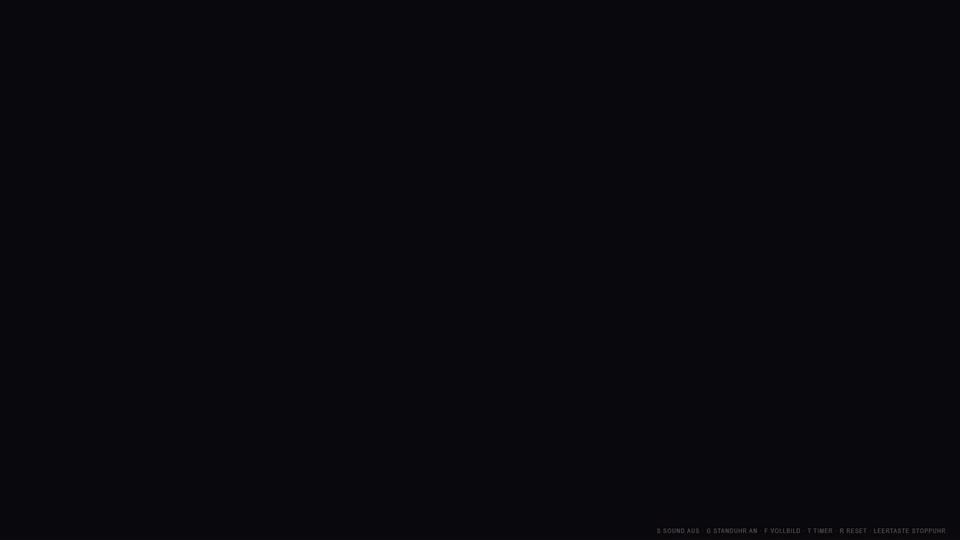
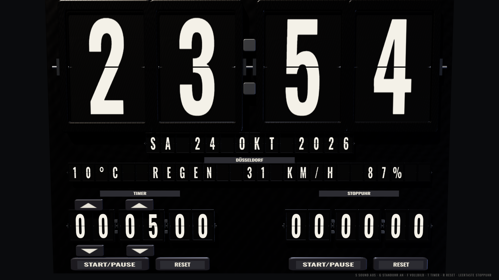
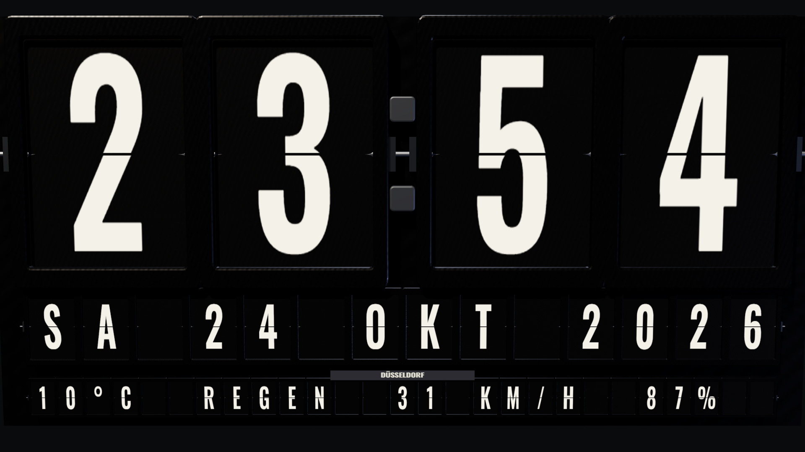

# Split-Flap Clock

A fullscreen split-flap clock (Solari board) for the browser, rendered in 3D with WebGL.
Flaps fall with weight, cast shadows and clack when they land; a grandfather clock strikes
the hour and the half hour. Plain HTML, CSS and JavaScript – no build step, no dependencies.



▶ [Demo video in full resolution (MP4)](docs/demo.mp4)



## Features

- **Time and date** as large split-flap modules (HH:MM, no seconds)
- **Current weather** for a configurable city via [Open-Meteo](https://open-meteo.com) (no API key)
- **Timer** (hours and minutes) on the left, **stopwatch** on the right, with 3D buttons
- **Realistic 3D**: Three.js, thick flaps with stacked edges, recessed frames, soft shadows, hinges
- **Sound** (optional): different clacks for hours and minutes, grandfather-clock chime on the
  hour and half hour, no melody; seconds stay silent
- **Kiosk mode** for Chrome and a **Windows screensaver** (`.scr`) showing only clock, date and weather

The display texts (weekdays, months, weather, labels) are German.

## Quick start

1. Clone the repository.
2. Open `index.html` in Chrome (or any browser with WebGL).
3. Optional: copy `config.example.js` to `config.js` and set your city:

```js
window.CLOCK_CONFIG = {
  messenger: false,
  city: { name: 'Berlin', latitude: 52.52, longitude: 13.405, timezone: 'Europe/Berlin' }
};
```

On Windows, `Uhr-starten.cmd` opens the clock in Chrome kiosk fullscreen (exit with Alt+F4).

## Keyboard

| Key | Action |
| --- | --- |
| `S` | Flap sound on/off |
| `G` | Grandfather chime on/off |
| `F` or double-click | Fullscreen |
| `T` | Start/pause timer |
| `R` | Reset timer |
| `Space` | Start/stop stopwatch |
| `Backspace` | Reset stopwatch |

Timer and stopwatch keep running across reloads (stored in `localStorage`).

## Screensaver (Windows)



`screensaver\build.cmd` compiles `FallblattUhr.scr` with the C# compiler that ships with
.NET Framework 4 – nothing to install. Right-click the file → *Install*. The screensaver shows
the page in Chrome kiosk mode with `?screensaver=1` (no timer or stopwatch) and exits on the
first mouse or keyboard input. Details in [screensaver/README.md](screensaver/README.md) (German).

## Tests

```sh
npm test                    # node --test, no packages required
node tools/check-render.js  # Windows + Chrome: renders screenshots headless and checks the layout
```

## Credits

- 3D rendering: [three.js](https://threejs.org) r160 (MIT), vendored in `vendor/`
- Font: [Oswald](https://fonts.google.com/specimen/Oswald) (SIL Open Font License), loaded from Google Fonts
- Weather data: [Open-Meteo](https://open-meteo.com) (CC BY 4.0)

## License

[MIT](LICENSE.md) © 2026 Michael Kupermann

---

## Deutsch

Vollbild-Fallblattuhr im Browser mit WebGL-3D: Uhrzeit, Datum, Wetter für eine einstellbare
Stadt, Timer und Stoppuhr, Klackgeräusche und Standuhr-Schläge zur vollen und halben Stunde.
Ohne Build und ohne Abhängigkeiten: `index.html` in Chrome öffnen, fertig. Stadt in `config.js`
einstellen (Vorlage: `config.example.js`). Unter Windows startet `Uhr-starten.cmd` die Uhr im
Kiosk-Vollbild; `screensaver\build.cmd` baut einen Bildschirmschoner.
